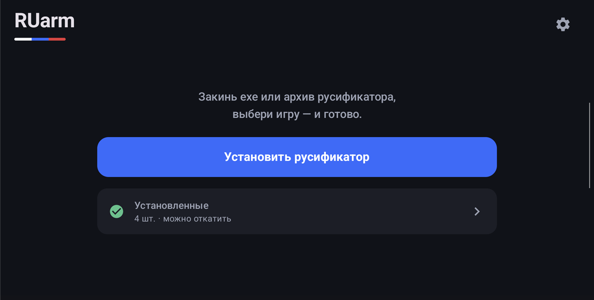
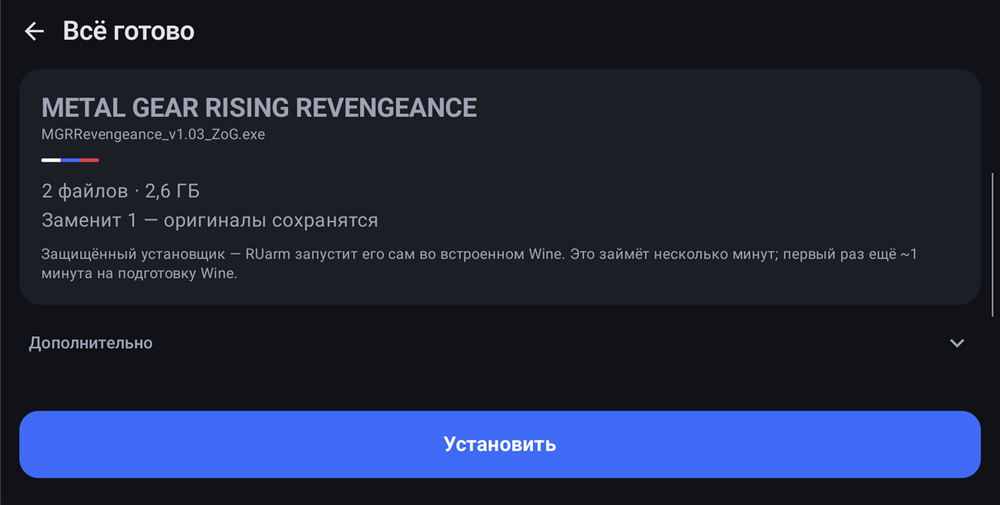
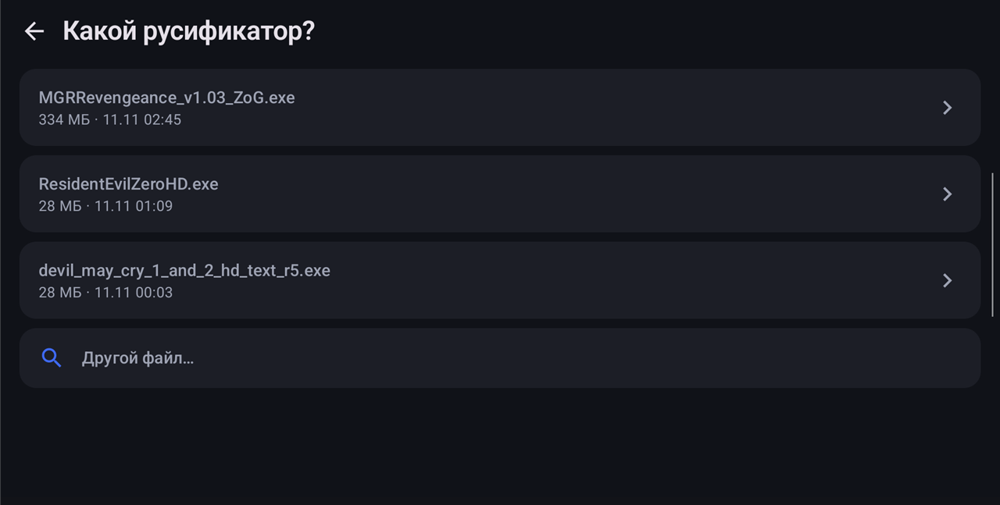
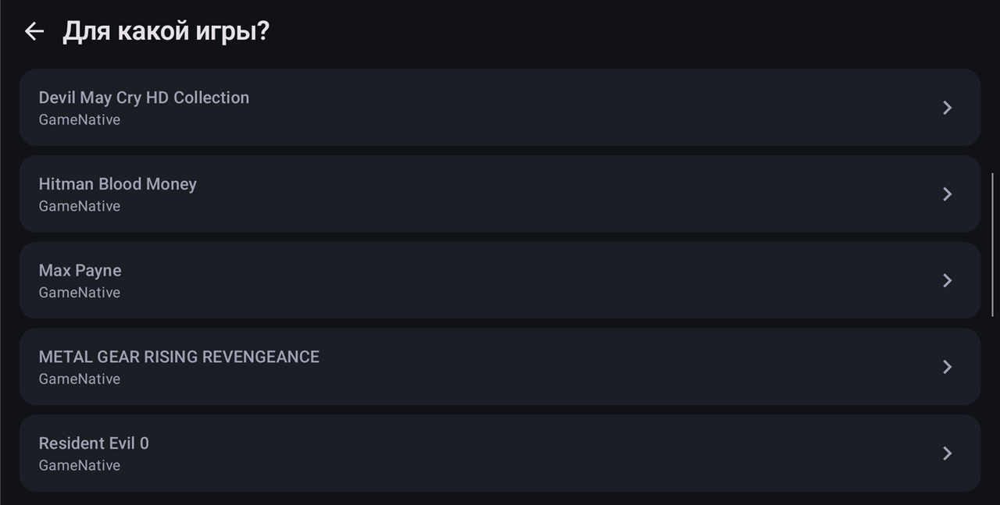

# RUarm

**Русификаторы для PC-игр на Android в пару нажатий**

Закинул exe или архив русификатора → выбрал игру → «Установить». Всё.

---

Для портативных консолей и телефонов на Android — **Retroid Pocket 6**, AYN Odin и других, —
где Steam-игры запускаются через **GameNative** или **GameHub**.

  
  
  
  

## ✨ Возможности

| | |
|---|---|
| 📦 **Архивы** | zip, 7z, rar (включая RAR5) и самораспаковывающиеся exe — ставит сам |
| 🧩 **Установщики** | Inno Setup (большинство русификаторов с ZoneOfGames) и NSIS — распаковывает без запуска |
| 🍷 **Защищённые установщики** | зашифрованные ZoG и подобные — запускает во **встроенном Wine** прямо на устройстве, без ПК и без GameNative |
| 🎯 **Умная установка** | сам находит игры GameNative и GameHub в памяти и на SD-карте, отбрасывает лишние папки и подстраивает регистр имён |
| ↩️ **Откат** | перед заменой сохраняет оригиналы — любую установку можно отменить |
| 🎮 **Геймпад** | A — выбрать, B — назад |

## 📲 Установка

1. Скачай `RUarm-x.y.z.apk` из [последнего релиза](https://github.com/sleeeeeeeeeepwalking/RUarm/releases/latest) и установи.
2. При первом запуске разреши **«Доступ ко всем файлам»**.
3. В **GameNative** включи установку игр во внешнее хранилище
   (*Настройки → Write to external storage*) и перенеси уже скачанные игры (*меню игры → Move to external storage*).

> [!NOTE]
> Игры во внутренней памяти GameNative закрыты для всех остальных приложений — поэтому шаг 3 обязателен.

### GameHub

Ставь GameHub [с официального сайта](https://gamehub.xiaoji.com/) — версия из Google Play не может хранить игры вне своей закрытой памяти.
При установке игры выбери *Папка установки → Изменить* → SD-карта или память и разреши доступ к файлам. RUarm найдёт такие игры сам.

## ⚠️ Ограничения

- Только **arm64** (Snapdragon и т. п.), Android 11+.
- Online-патчеры с окном (Siberian Studio / Russianizer) встроенный Wine не запустит — их нужно запускать в самом GameNative
  (*настройки контейнера → Executable Path*).
- Первый защищённый установщик распаковывает Wine: ~1,8 ГБ во внутренней памяти, около минуты.
- Приложение собрано под Android 9 (targetSdk 28), как Winlator и GameNative, — иначе встроенный Wine не запустится.
  Поэтому его нет в Google Play, ставится только из APK.

## 🐞 Нашёл проблему?

Открой [issue](https://github.com/sleeeeeeeeeepwalking/RUarm/issues/new): напиши название игры, ссылку на русификатор и что пошло не так.

## 🛠 Для разработчиков

Сборка, подпись и что за готовые бинарники лежат в репозитории — в [BUILDING.md](BUILDING.md).
Лицензии встроенных компонентов (Wine, Box64, 7-Zip, innoextract и др.) — в [THIRD_PARTY_NOTICES.md](THIRD_PARTY_NOTICES.md).
